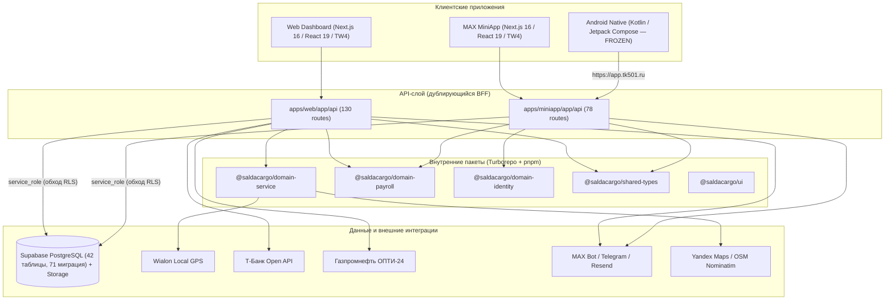

# Архитектурный и продуктовый аудит SALDA (ТК501) → Enterprise / PRO B2B-продукт

> **Роль:** Principal Software Architect & Technical Product Manager  
> **Объект аудита:** монорепозиторий `c:\salda` (3 приложения, 6 пакетов, 71 SQL-миграция, 208 API-роутов, 355 исходных файлов `.ts`/`.tsx`/`.kt`)  
> **Цель:** оценить текущую зрелость системы и зафиксировать план её трансформации в коробочный модульный B2B SaaS-продукт, готовый к безопасной и масштабируемой продаже сторонним транспортным компаниям и СТО без ручной доработки кода под каждого клиента.

---

## Executive Summary (Сводка готовности к B2B-продажам)

| Измерение                                       | Текущая оценка | Вердикт                                                                                                                                                   |
| ----------------------------------------------- | -------------: | --------------------------------------------------------------------------------------------------------------------------------------------------------- |
| **Функциональная полнота (Product-Market Fit)** |   **8.5 / 10** | Богатая, реально работающая ERP для ТК + СТО (Web + MAX MiniApp + нативный Android). Заглушек почти нет.                                                  |
| **Архитектура и поддерживаемость**              |   **4.5 / 10** | Хороший фундамент (Next.js 16, Turborepo, Supabase, Kotlin Compose), но монолитные страницы до 7 468 строк, дублирование логики и 1 733 `any`.            |
| **Готовность к Multi-tenancy & White-label**    |   **1.0 / 10** | 100% single-tenant: **0** tenant-колонок в БД, сотни жёстких привязок к ИП Нигамедьянов / ТК501 / Верхней Салде / конкретным машинам.                     |
| **Информационная безопасность и RBAC**          |   **1.5 / 10** | **Блокер продаж (P0):** утечки live-ключей в git, обход авторизации любым cookie, 0% Zod-валидации, 0% проверки ролей в API, открытые таблицы в Supabase. |
| **Надёжность, Observability и DevOps**          |   **2.5 / 10** | Нет Sentry/логов/ретраев, 2 теста на весь проект (`pnpm test` = 0 задач), нет Docker, в CI нет `lint`/`test`.                                             |

> **Главный вывод:** Продукт уже обладает сильной бизнес-логикой, закрывающей реальные боли транспортной компании, но **в текущем виде его категорически нельзя продавать внешним клиентам** ни по модели SaaS, ни по модели On-Premise. Причина — критические уязвимости авторизации/ключей (P0), полное отсутствие изоляции данных (Multi-tenancy) и жёсткий хардкод под одного заказчика.

---

## Блок 1. Карта текущей реализации (Что уже есть)

### 1.1. Функциональный срез: рабочие фичи vs заглушки и незавершённые модули

Система представляет собой **полноценную операционную ERP для автотранспортной компании с собственным СТО**, разделённую на 3 клиентских приложения.

#### Реально работающий функционал

1. **Web Dashboard (`apps/web`, 11 рабочих разделов, 130 API-роутов):**
   - **Операционный дашборд** (`apps/web/app/(dashboard)/page.tsx`) — панель ежедневного контроля, сводка по рейсам, финансам и долгам (`DailyControlPanel.tsx`).
   - **Заявки, Конвейер & Wialon / АТИ / Экспедирование** (`apps/web/app/(dashboard)/ati/page.tsx`, `OrdersPipelineView.tsx`, `expeditor-board.tsx`) — 6-папочный конвейер заявок (Лист ожидания → Назначенная → В пути → На ревью → Сбор документов → Архив), экспедиторская доска, трекинг Wialon, генерация печатных форм ТН, Путевого листа 4-С и XML ЭТрН.
   - **Ревью и закрытие рейсов** (`apps/web/app/(dashboard)/review/page.tsx`) — проверка отчётов водителей, корректировка ставок/расходов/ЗП, финализация рейсов.
   - **СТО / Гараж** (`apps/web/app/(dashboard)/garage/page.tsx`) — заказ-наряды (свои авто и внешние клиенты), склад запчастей, каталог работ и неисправностей, начисление ЗП механикам, плановое ТО.
   - **Персонал и расчёт ЗП** (`apps/web/app/(dashboard)/staff/page.tsx`) — табель, автоматический расчёт ЗП водителей/грузчиков/механиков, расчётные листы, официальное трудоустройство, удержания по ИЛ, подотчётные деньги, взаиморасчёты.
   - **Финансы, Банк и Топливо** (`apps/web/app/(dashboard)/finance/page.tsx`) — мультикассовый учёт (кошельки: сейф, карты, расчётный счёт, топливный куб), сверка с Т-Банком, топливные карты ОПТИ-24, платёжный календарь, ежедневный аудит остатков.
   - **Дебиторка и Контрагенты** (`apps/web/app/(dashboard)/receivables/page.tsx`, `apps/web/app/(dashboard)/counterparties/page.tsx`) — контроль оплат, слияние дублей контрагентов, акты/счета, долги поставщикам.
   - **Автопарк и ретроспективный ввод** (`apps/web/app/(dashboard)/fleet/page.tsx`, `apps/web/app/(dashboard)/retro/page.tsx`, `apps/web/app/(dashboard)/deliveries/page.tsx`) — справочник ТС, привязка к Wialon, приём публичных заявок с сайта.
2. **MAX MiniApp (`apps/miniapp`, 27 рабочих страниц, 78 API-роутов):**
   - Кабинеты **водителя** (активный рейс, добавление точек/расходов, фото-отчёты, завершение рейса, финансы), **грузчика** (смены ПРР), **механика** (заказ-наряды, склад, ЗП) и **админа/диспетчера** (мобильное управление рейсами, гаражом, персоналом, финансами, дебиторкой).
3. **Нативное Android-приложение (`apps/android`, 22 Kotlin-файла, Jetpack Compose — ЗАМОРОЖЕНО на этапе PRO-трансформации):**
   - Полноценный нативный клиент для 4 ролей: Диспетчер, Водитель, Механик, Грузчик, работающий поверх REST API `apps/miniapp`.

#### Что является заглушкой, перенаправлением или работает с ограничениями

- **3 страницы-редиректа в `apps/web`:** `/orders` → `/ati`, `/loans` → `/finance?tab=calendar`, `/payables` → `/counterparties` (наследие рефакторинга).
- **Интеграция с биржей ATI.SU — отсутствует:** раздел `/ati` — это внутренний учёт договоров-заявок и парсинг PDF; прямых вызовов API `api.ati.su` нет.
- **AI-помощник в СТО (`apps/web/app/api/garage/ai-prompt/route.ts`) — полуручной режим:** API не вызывает LLM, а лишь формирует текст системного промпта для ручного копирования во внешний чат.
- **Парсер PDF-договоров (`apps/web/app/api/ati/parse-contract/route.ts`) — не работает в облаке Vercel:** вызывает локальный Python-скрипт через `execFile('python', ['scripts/parse_contract.py'])`.
- **Проверка подписи MAX MiniApp (`apps/miniapp/lib/auth/max-auth.ts`) — заглушка `TODO (после MVP)`:** криптографическая верификация `initData` отключена.
- **DaData, VK API, экспорт Excel/DOCX:** в кодовой базе отсутствуют.

---

### 1.2. Архитектура и стек технологий

**Оценка масштабируемости стека:**

- **Сильные стороны:** современный стек (Next.js 16, React 19, TypeScript 5.4, Turborepo, pnpm, PostgreSQL/Supabase, Kotlin Jetpack Compose).
- **Архитектурные узкие места:**
  1. **Два параллельных бэкенда (`apps/web/app/api` и `apps/miniapp/app/api`):** 208 API-роутов размазаны по двум Next.js-приложениям с дублированием бизнес-логики.
  2. **Прямые запросы к БД из UI/роутов через `service_role`:** отсутствует слой сервисов с единым контекстом авторизации и тенанта.
  3. **Синхронное выполнение тяжёлых операций в Serverless:** кроны Wialon, сверки Т-Банка и рассылки выполняются синхронно в HTTP-роутах без очередей задач.

---

### 1.3. Технический долг и «костыли»

1. **«Божественные» монолитные файлы (God Components):**
   - `apps/web/app/(dashboard)/garage/page.tsx` — **7 468 строк**
   - `apps/web/app/(dashboard)/review/page.tsx` — **7 265 строк**
   - `apps/web/app/(dashboard)/staff/page.tsx` — **5 935 строк**
   - `apps/web/components/OrdersPipelineView.tsx` — **4 936 строк**
   - `apps/web/components/DailyControlPanel.tsx` — **4 828 строк**
   - `apps/web/app/(dashboard)/ati/page.tsx` — **3 843 строки**
   - `apps/miniapp/app/admin/trips/page.tsx` — **3 262 строки**
   - `apps/android/.../DispatcherScreen.kt` — **3 194 строки**
   - `apps/web/app/(dashboard)/receivables/page.tsx` — **2 775 строк**
   - `apps/android/.../MechanicScreen.kt` — **2 753 строки**

2. **Деградация типизации:**
   - **1 733 вхождения `: any` / `as any`** и **168 директив `eslint-disable ... no-explicit-any`**.
   - В `apps/web/next.config.ts` (`L5-7`) включён `typescript: { ignoreBuildErrors: true }`.
   - Корневой `eslint.config.mjs` задаёт `eslint-plugin-boundaries`, но локальные конфиги в `apps/web` и `apps/miniapp` его перезаписывают.

3. **Критические дубли бизнес-логики:**
   - `apps/web/lib/tripFinancials.ts` (526 L) vs `apps/miniapp/lib/tripFinancials.ts` (530 L) — разошедшиеся копии финансового ядра.
   - `api/public/delivery-order/route.ts`, `api/loader/shift/route.ts`, `api/wallets/route.ts`, `staff/settle` vs `admin/staff-settle` — параллельные реализации.
   - В `packages/ui/package.json` указан `tailwindcss@^3.4.0` при Tailwind v4 в приложениях.

4. **Неаккуратность репозитория и сломанные скрипты:**
   - В корне лежат бинарники и черновики (`TK501.apk`, `.docx`, 4 HTML-превью, `.jpg`/`.pdf` бланки, `scratch/`, `__pycache__/`).
   - В `supabase/migrations/` из 71 файла **5 нестандартных** (`.bak`, 3 файла без timestamp-префикса).
   - В корневом `package.json` сломаны скрипты `deploy:all` (нет `deploy:miniapp`) и `gen:types` (пишет в несуществующую папку `packages/shared-types/` вместо `packages/types/`).

---

## Блок 2. Готовность к продаже «из коробки» (Multi-tenancy и White-label)

### 2.1. Изоляция данных (Multi-tenancy)

**Текущий статус: 0% готовности.**

1. **Нет сущности `organizations` / `tenants`:** ни в одной из **42 таблиц** и **71 миграции** нет колонок `organization_id`, `tenant_id`, `company_id` или `workspace_id`.
2. **RLS (Row Level Security) сломан и не используется:**
   - **13 из 42 таблиц вообще не имеют RLS** (включая `wallets`, `legal_entities`, `payroll_rules`, `audit_log`, `work_catalog`, `client_vehicles*`).
   - На `client_vehicles*` нет RLS и выдан `GRANT ALL TO anon, authenticated`.
   - На `loans`, `manual_receivables`, `receivable_follow_ups`, `payment_calendar_*`, `daily_finance_audits` стоят политики `USING (true) WITH CHECK (true)` для `PUBLIC` (включая `anon`).
   - **200 из 208 API-роутов** (126/130 в `web` + 74/78 в `miniapp`) используют `createAdminClient()` (`SUPABASE_SERVICE_ROLE_KEY`), полностью обходя RLS.
   - SQL-функции `auth_user_roles()` и `is_admin_or_owner()` в `init_schema.sql` привязаны к `auth.uid()` и фактически мертвы.

---

### 2.2. Конфигурируемость и брендирование (White-label)

| Категория хардкода            | Где зашито в коде (примеры)                                                                                                                                                            | Куда вынести для PRO                                                             |
| ----------------------------- | -------------------------------------------------------------------------------------------------------------------------------------------------------------------------------------- | -------------------------------------------------------------------------------- |
| **Реквизиты юрлица и ЭДО**    | `ИП Нигамедьянов А.С.`, ИНН `660704814106`, ОГРН, адрес, телефон, ЭДО ID `2BM-660704814106-...` в `ati/page.tsx`, `expeditor-print-docs.tsx`, `payslip-modal.tsx`, `etrn-xml/route.ts` | Таблица `legal_entities` с привязкой к `organization_id`                         |
| **Бренд, домен, название**    | **329 вхождений** `ТК501`, `Верхняя Салда`, `saldacargo`, `ancargo66`; в Android зашит `https://app.tk501.ru`                                                                          | `organizations.branding_json` (логотип, цвета, название, домен, город)           |
| **Клиенты и бизнес-правила**  | **281 вхождение** `ВСМПО`, `АВИСМА`, `Геостройиндустрия`, `Шайтанка`, `Валдай`; `GEOSTROY_CLIENT_ID` и список строгих контрагентов                                                     | Флаг `counterparties.requires_strict_docs: boolean` + правила в БД               |
| **Геозоны и автопарк Wialon** | Координаты Верхней Салды, Шайтанки, Маминского в `wialonTracker.ts`; `WIALON_ID_TO_PLATE` в `webhooks/wialon/route.ts`                                                                 | Таблица `geofences` + `assets.wialon_unit_id`                                    |
| **Банк и кошельки**           | Счёт `40802810500001961654` в `tbank.ts`; захардкоженные UUID кошельков/категорий в `wallets/transfer`, `set-balance`, `staff/settle`, `driver/finance`                                | Системные типы кошельков + шифрованное хранилище `organization_integrations`     |
| **Сотрудники в миграциях**    | Имена сотрудников в SQL-миграциях (`20260501000000`, `20261025000002`)                                                                                                                 | Чистый DDL в миграциях + отдельный demo-seed                                     |
| **Модульность и тарифы**      | Все разделы всегда включены                                                                                                                                                            | Feature Flags (`enabled_modules`) + квоты (`max_vehicles`) на уровне организации |

---

### 2.3. Ролевая модель и права доступа (RBAC)

- **Рассинхрон ролей:** в БД 12 ролей (`owner`, `admin`, `driver`, `loader`, `mechanic`, `mechanic_lead`, `accountant`, `welder`, `painter`, `electrician`, `handyman`, `cleaner`), в `packages/types/src/enums.ts` — 8. Роли `dispatcher` нет в БД.
- **Отсутствие RBAC на бэкенде:** **0 из 130** роутов в `apps/web` и **0 из 28** `/api/admin/*` роутов в `apps/miniapp` проверяют роль вызывающего.
- **Целевая модель:** Permission-based RBAC с матрицей прав (`finance.view`, `finance.transfer`, `payroll.approve`, `trips.review`, `garage.manage`, `users.manage`) и единым guard-декоратором `withAuth({ permission, module })`.

---

## Блок 3. PRO-уровень: Надёжность, Безопасность и DevOps

### 3.1. Безопасность и уязвимости (Матрица P0 / P1)

#### Критические (P0 — немедленное устранение)

1. **Полный обход авторизации в Web (`apps/web/middleware.ts:6,25`):** проверяется только наличие непустого cookie `salda_auth_token` без подписи/JWT/БД.
2. **Захват любого аккаунта в MiniApp (`apps/miniapp/app/api/auth/*`):**
   - `POST /api/auth/session` выставляет `salda_user_id` на любой `user_id` без проверки (`httpOnly: false`).
   - `POST /api/auth/set-pin` перезаписывает PIN любого пользователя при отсутствии `current_pin`.
   - `POST /api/auth/max` не проверяет HMAC-подпись `initData`.
   - В `apps/miniapp` нет `middleware.ts`, 37/78 API-роутов (включая 12 `/api/admin/*` и `POST /api/wallets/set-balance`) открыты без авторизации.
3. **Утечка боевых секретов в Git:**
   - **Боевой `SUPABASE_SERVICE_ROLE_KEY`** и URL БД + PIN-коды админов в `.claude/settings.local.json` (`L48, 64, 103, 104`).
   - **SFTP-пароль продакшн-сервера REG.RU** в `scripts/deploy/deploy_to_regru.py` (`L17-20`).
   - **Боевой Wialon API Token** в `wialon-sync/route.ts`, `webhooks/wialon/route.ts`, `wialonTracker.ts`.
   - **Боевой MAX Bot Token** в `evening-audit/route.ts`.
   - **Yandex Maps API Key** в обоих `delivery-order/route.ts`.
4. **Открытые финансовые/GPS/upload эндпоинты и IDOR:**
   - `POST /api/wallets/set-balance` (miniapp) — без авторизации.
   - `GET /api/driver/finance?user_id=<uuid>` — IDOR чужих финансов.
   - `GET /api/cron/wialon-sync?view=1` — публичный GPS автопарка; `CRON_SECRET` не проверяется ни в одном из 4 кронов.
   - `POST /api/driver-documents/upload` — открытая загрузка файлов с `CORS: *` без валидации типа/размера.

#### Высокие (P1)

5. **0% валидации входных данных:** `zod` используется в **0 из 128** JSON-роутов.
6. **PostgREST Filter Injection:** строковая интерполяция в `.or()` в **26 файлах** (17 `web`, 9 `miniapp`).
7. **Отсутствие Rate Limiting и хэширования PIN:** 4-значный PIN в plaintext.
8. **Отключённая проверка TLS (`apps/web/lib/tbank.ts:35`):** `rejectUnauthorized: false`.
9. **Отсутствие Security Headers** (`HSTS`, `CSP`, `X-Frame-Options`, `X-Content-Type-Options`, `Referrer-Policy`).

---

### 3.2. Обработка ошибок и наблюдаемость (Observability)

- **0** APM/мониторинга (нет Sentry, Pino, OpenTelemetry) — только 221 сырой `console.*`.
- В `apps/web` отсутствуют React Error Boundaries (`error.tsx` / `global-error.tsx`).
- Нет retries/backoff/Circuit Breaker/DLQ на внешних интеграциях; `.github/workflows/wialon-sync.yml` всегда возвращает `exit 0` даже при ошибке HTTP.

---

### 3.3. Покрытие тестами и CI/CD

- Всего **2 тестовых файла** на 355 исходников (`payroll.test.ts` без раннера + 6 unit-тестов Android); `pnpm test` выполняет **0 задач**.
- `.github/workflows/ci.yml` гоняет только `typecheck` и `build` (нет `lint`, `test`, `format:check`).
- Нет `Dockerfile` / `docker-compose.yml`.

---

## Блок 4. План трансформации (Roadmap до PRO-версии)

### Этап 1 (Критично — 2–3 недели): Безопасность, Стабильность и Декуплинг

1. **Ротация и чистка секретов:** перевыпустить ключи Supabase (`service_role`), Wialon, MAX Bot, Yandex Maps, SFTP REG.RU; удалить `.claude/settings.local.json` из трекинга и вычистить историю git; актуализировать `.env.example`.
2. **Закрытие P0-дыр авторизации:** переход на Supabase Auth (JWT) / подписанные `httpOnly` сессии, хэширование PIN, закрытие `/api/auth/session` и `/api/auth/set-pin`, HMAC-проверка MAX `initData`, `middleware.ts` для `apps/miniapp`, защита кронов `CRON_SECRET`, Rate Limiting, Security Headers, экранирование `.or()`, TLS-сертификат Минцифры для Т-Банка.
3. **Единый API-guard и валидация:** `createApiHandler({ auth, permissions, module, schema })` с обязательным Zod; вынос дублей `tripFinancials.ts` и `wallets` в `packages/service`; удаление `ignoreBuildErrors: true`; починка `eslint-plugin-boundaries` и `gen:types`.
4. **Observability:** Sentry (Web + MiniApp), Pino JSON-логи, `error.tsx` в `apps/web`, алерты на падения кронов (`exit 1` в `wialon-sync.yml`).

### Этап 2 (B2B-фундамент — 4–6 недель): Multi-tenancy, Модульность, RBAC, Биллинг и РФ-контур

1. **Мультитенантная схема БД + бесшовная миграция ТК501:**
   - Таблицы `organizations`, `organization_members`, `organization_integrations` (шифрование AES-256-GCM), `geofences`, `subscriptions`, `organization_modules`.
   - `organization_id NOT NULL` во всех 42 таблицах, перенос всех исторических данных ТК501 в **Тенант №1** без потерь.
   - Строгий RLS на **100% таблиц**, удаление всех `USING (true)` и `GRANT ALL TO anon`, отказ от `service_role` в пользовательских роутах.
2. **Модульный конструктор (Feature Flags & Module Isolation):**
   - Выделение изолированных бизнес-модулей: `transport` (Рейсы + Логистика), `garage` (СТО / Гараж), `expeditor` (Экспедирование / АТИ), `warehouse` (Склад), `payroll` (Расчёт ЗП и Персонал), `finance` (Финансы и Дебиторка).
   - Проверка `moduleEnabled(orgId, module)` на уровне API-guard и динамического меню UI.
3. **Permission-based RBAC:** синхронизация ролей (включая `dispatcher`), матрица прав доступа на 100% эндпоинтов.
4. **Абстрактные адаптеры интеграций и White-label:**
   - Интерфейсы `GpsProvider` (реализация: Wialon; задел: ГЛОНАССSoft), `BankProvider` (Т-Банк; задел: Сбер/Точка/Альфа), `FuelCardProvider` (ОПТИ-24), `MessengerProvider` (MAX / Telegram), `AccountingExporter` (задел: 1С).
   - Вынос всех реквизитов, ЭДО, геозон, брендинга и правил контрагентов в «Настройки компании» + Онбординг-визард.
   - Перевод парсера PDF-договоров с локального Python на чистый Node.js/TS.
5. **Биллинг и лимиты:** комбинированная подписка (выбранные модули + лимит активных ТС), мягкая/жёсткая блокировка (read-only при просрочке), выставление B2B-счетов юрлицам + онлайн-оплата.
6. **Подготовка к переезду в РФ-контур (152-ФЗ):** контейнеризация (Docker) и план миграции БД + приложений с Vercel/Supabase Cloud на российский облачный провайдер (Yandex Cloud / Selectel / Timeweb Cloud + Self-hosted Supabase / Managed PostgreSQL).

### Этап 3 (Инженерная культура — 3–4 недели): Автотесты, Рефакторинг, DevOps и AI-правила

1. **Декомпозиция God-компонентов:** разбиение 8 гигантских Web/MiniApp файлов на модульные фичи (≤ 400 строк/файл) и поэтапное устранение `any`.
2. **Пирамида тестирования:** Vitest (unit: `payroll`, `tripFinancials`, `wialonTracker`, `etrnXmlGenerator`; integration: тесты RLS-изоляции тенантов, RBAC и финансов) + Playwright E2E (5–7 сквозных сценариев).
3. **CI/CD и Docker-инфраструктура:** расширение `ci.yml` (`format:check` → `lint` → `typecheck` → `test` → `build`), `Dockerfile` + `docker-compose.yml` (под SaaS в РФ-облаке и опциональный Enterprise On-Premise), очереди задач с ретраями и DLQ для кронов.
4. **Разморозка Android (Post-PRO):** после стабилизации PRO API — обновление единого нативного приложения (RuStore / Google Play) с выбором компании и динамическим брендингом.

---

## Блок 5. Зафиксированные продуктовые и архитектурные решения (Target PRO Spec)

1. **Модель распространения:** основной фокус — **облачный Multi-tenant SaaS**; готовность к запуску в **Docker** как опция для крупных Enterprise On-Premise клиентов.
2. **География и 152-ФЗ:** клиенты в РФ → закладываем миграцию инфраструктуры из Vercel/Supabase Cloud в **российский облачный контур** (Yandex Cloud / Selectel / Timeweb Cloud + Self-hosted Supabase / PostgreSQL).
3. **Модульный конструктор (ключевой приоритет):** независимая продажа модулей («Транспортная компания», «СТО / Гараж», «Экспедирование», «Склад», «Расчёт ЗП») через **Feature Flags** на уровне организации и строгую изоляцию модулей в коде.
4. **Мобильный клиент и заморозка Android:** на весь период трансформации до PRO **`apps/android` полностью заморожен**. Все фичи, багфиксы и рефакторинг ведутся строго в **`apps/web`** и **`apps/miniapp`**. К единому Android-приложению с выбором компании и динамическим брендингом вернёмся после стабилизации PRO API.
5. **Биллинг и монетизация:** комбинированная подписка (**пакет модулей + лимит активных ТС**), мягкая/жёсткая блокировка (**read-only** при просрочке), счета юрлицам + онлайн-оплата.
6. **Интеграции и автономность:** каждый клиент вводит свои зашифрованные API-ключи в настройках компании; интеграции строятся через **абстрактные адаптеры** (`BankProvider`, `GpsProvider`, `FuelCardProvider`, `MessengerProvider`, `AccountingExporter`).
7. **Миграция ТК501:** текущий продакшн ТК501 становится **Тенантом №1** с бесшовной миграцией всех исторических данных, рейсов, кошельков, сотрудников и заказ-нарядов СТО.

---

## Блок 6. Отложенные правки БД

- ~~**Очистка legacy-провайдера `resend` (24.11.2026):**~~ **Выполнено** в миграции `20261124000002_grant_driver_documents_and_cleanup_resend.sql` (удалены записи `provider = 'resend'` из `public.organization_integrations`, `document_sends.provider` переведён на `DEFAULT 'smtp'`, выданы `GRANT ALL` на `public.driver_documents`).
